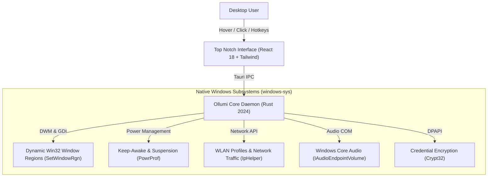

# 🌟 Ollumi

**A lightweight, fluid, and local-first desktop notch companion for Windows 10 & 11.**

[Download Latest Installer](https://github.com/AdityaAryan-1408/UTool/releases/latest) • [Key Features](#-key-features) • [Real Performance Metrics](#-real-performance-metrics) • [Architecture](#-tech-stack--architecture) • [Privacy Guarantee](#-privacy--security-guarantee)

---

## 📖 Overview

**Ollumi** sits subtly at the very top of your primary display as a sleek, non-intrusive notch. It stays invisible to your workflow until you need it:

* **Stage 1 (Idle Standby)**: A minimal 38px pill flush with your screen bezel displaying your personalized greeting and active status.
* **Stage 2 (Hover Peek)**: Hovering your cursor smoothly expands the notch into an at-a-glance telemetry bar (CPU, RAM, battery, active clipboard item).
* **Stage 3 (Full Drawer)**: Clicking opens a full, glassmorphic productivity dashboard containing your daily tasks, clipboard history, file drop shelf, system controls, and real-time hardware gauges.

Mouse clicks outside the notch pass straight through to whatever application you are working in.

---

## ⚡ Real Performance Metrics

Unlike bloated Electron utilities that consume hundreds of megabytes of memory and constant background cycles, Ollumi is built with native Rust and Tauri v2:

| Metric | Measured Real Value | How It's Achieved |
| :--- | :--- | :--- |
| **Idle Memory (RAM)** | **~3.8 MB – 12 MB** | Native Rust daemon utilizing the evergreen Windows WebView2 engine. |
| **Idle CPU Usage** | **0.0%** | Event-driven architecture with zero background polling loops when collapsed. |
| **Hit-Testing Overhead** | **0 ms** | Dynamic native Win32 window regions (`SetWindowRgn`); non-notch screen area passes clicks natively. |
| **Transition Animation** | **60 – 144 Hz (Fluid)** | Custom calibrated cubic-bezier curve (`[0.22, 1, 0.36, 1]`) with hardware-accelerated compositing. |
| **Screen Capture Latency** | **< 40 ms** | Direct GDI bit-blit (`GetDC` / `StretchBlt`) with automatic resolution downscaling. |
| **Binary Footprint** | **~12 MB** | Stripped release binary containing embedded web assets and zero bundled Chromium runtimes. |

---

## ✨ Key Features

### 📅 1. Today Dashboard
* **Dynamic Time & Weather**: Live temperature, weather condition icons, and wind speed powered by Open-Meteo.
* **Weekly Agenda**: 7-day calendar strip to plan and filter objectives.
* **Interactive To-Do List**: Quick task entry with completion tracking and per-day persistence.
* **Persistent Focus Timer**: Pomodoro-style 25 & 50-minute timers that continue counting even when the app is closed.
* **Quick Scratchpad**: Local device note with instant paste-and-replace support.

### 📋 2. Clipboard Vault & Batch Paste
* **Automatic Local History**: Captures copied text snippets and images without cloud syncing.
* **Search & Previews**: Filter by Text or Images with rendered previews.
* **Batch Paste (`Ctrl+Shift+V`)**: Sequentially paste previously copied items in order.
* **Quick Copy Queue**: Ephemeral 60-second copy queue pill displayed directly on the notch.

### 📥 3. The Drop Shelf (Staged Scratchpad)
* **Drag-and-Drop Zone**: Drop files, text snippets, and web links onto the shelf.
* **Smart URL Cards**: Automatically generates `.url` internet shortcuts with rich OpenGraph metadata previews.
* **In-Memory ZIP Packaging**: Select multiple staged files and download them as a consolidated ZIP archive.
* **3-Day Local TTL**: Staged files automatically expire after 72 hours to keep storage clean.

### 📊 4. Real-Time Hardware Telemetry
* **Hardware Gauges**: Live CPU %, RAM usage, and dedicated GPU 3D engine utilization (`PDH`).
* **Disk & Network Traffic**: Real-time upload and download transfer speeds.
* **Integrated Speed Test**: Measure connection latency, jitter, download, and upload speeds against Cloudflare edge servers.

### 🎛️ 5. System Quick Controls
* **Master Volume & Brightness**: Hardware slider controls with direct WMI/CIM integration.
* **Keep-Awake Toggle**: Temporarily prevents display sleep and Windows idle suspension (`SetThreadExecutionState`).
* **Wi-Fi Scanner**: Discover nearby networks, check signal strength, and connect directly.

### 🪄 6. Circle Search (AI Vision)
* **Lasso Screen Snip**: Draw a circle around any image, code snippet, or UI element on screen (`Ctrl+Shift+S`).
* **Instant AI Analysis**: Sends only the selected crop directly to your configured AI provider using your own private API key.

---

## 🔒 Privacy & Security Guarantee

Ollumi was engineered from day one with a strict **local-first philosophy**:

* **Zero Telemetry / Zero Tracking**: No analytics, no crash reports sent to external servers, and no tracking pings.
* **100% Local Storage**: All notes, tasks, settings, clipboard items, and shelf files reside exclusively on your machine in `%APPDATA%\com.ollumi.desktop`.
* **Hardware-Encrypted Credentials**: AI API keys are stored encrypted via the **Windows Data Protection API (`CryptProtectData`)**, tied directly to your Windows login credentials.
* **Your Own Keys**: AI features connect directly from your machine to the provider (e.g. Groq) without intermediary proxies.

---

## 🛠️ Tech Stack & Architecture

* **Core Runtime**: [Tauri v2](https://tauri.app/)
* **Systems Language**: [Rust 2024](https://www.rust-lang.org/) with raw Win32 bindings (`windows-sys` 0.52)
* **Frontend Framework**: [React 18](https://react.dev/) + [Vite 6](https://vitejs.dev/)
* **Styling & Physics**: [Tailwind CSS](https://tailwindcss.com/) + [Framer Motion](https://www.framer.com/motion/)
* **Icons**: [Lucide React](https://lucide.dev/)

---

## 🚀 Installation

### Option 1: Standard Installer (Recommended)
1. Head to the **[Releases Page](https://github.com/AdityaAryan-1408/UTool/releases/latest)**.
2. Download **`Ollumi_0.1.0_x64-setup.exe`**.
3. Run the installer and launch Ollumi from your Start Menu.

### Option 2: MSI Package
Download **`Ollumi_0.1.0_x64_en-US.msi`** for enterprise or silent administrative deployments.

> [!NOTE]
> **Windows SmartScreen Alert**:
> Because Ollumi is a new open-source project and is not signed with an enterprise commercial certificate ($300+/year), Windows Defender SmartScreen may display: *"Windows protected your PC"*.
> Click **"More info"** → **"Run anyway"** to complete installation.

---

## ⌨️ Default Keyboard Shortcuts

| Shortcut | Action |
| :--- | :--- |
| `Ctrl + Shift + H` | Toggle Notch visibility (Show / Hide) |
| `Ctrl + Shift + S` | Activate AI Circle to Search |
| `Ctrl + Alt + X` | Instant Screen Capture to Shelf |
| `Ctrl + Shift + V` | Batch Paste recent clipboard queue |
| `Escape` | Dismiss expanded drawer / close active overlays |

---

## 📄 License

This project is licensed under the [MIT License](LICENSE) — free and open for personal and commercial use.
